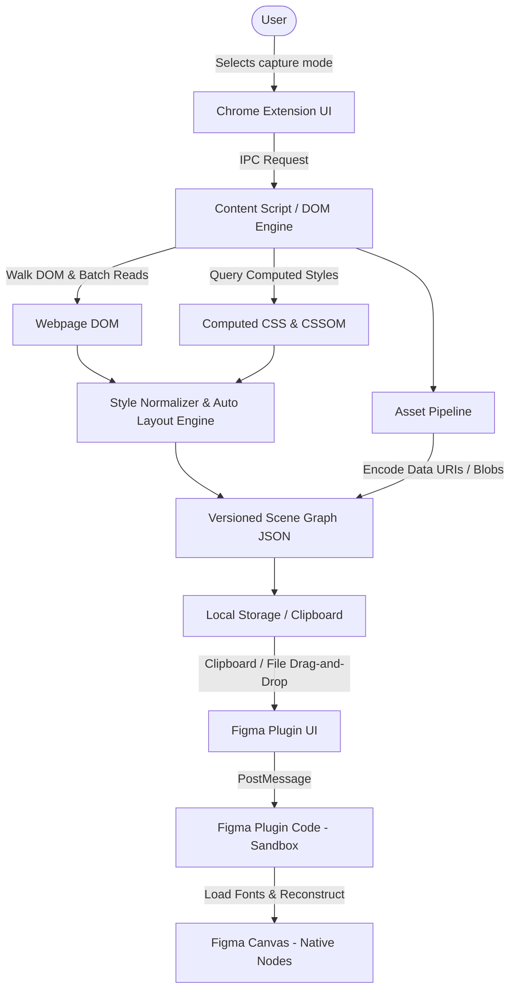

# FrameForge Architecture Specification

## 1. Executive Summary & Vision

**FrameForge** is an original, production-minded Chrome Extension and Figma integration that captures real web interfaces and converts them into high-fidelity, natively editable Figma documents.

Unlike screenshot-based or flat vector tools, FrameForge reconstructs:
- **Semantic layer hierarchy**: Frames, true TextNodes, Vector paths, and image fills.
- **Inferred Auto Layout**: Converts Flexbox and CSS Grid layouts into Figma Auto Layout with proper axis sizing, item spacing, and padding.
- **Native typography**: Font loading, weight mapping, line height, letter spacing, text alignment, and graceful fallbacks.
- **Visual fidelity**: Fills (solid, linear gradients), borders, corner radii, drop shadows, inner shadows, and opacity.
- **Design Intelligence**: Color palettes (HEX, RGB, HSL, OKLCH, nearest Tailwind token), typography inventory, asset catalog, WCAG contrast auditing with uncertainty detection, and `DESIGN.md` / `SKILL.md` generation for AI coding agents.

---

## 2. Monorepo Organization

The project is structured as a TypeScript monorepo using npm workspaces:

```text
export-web-to-figma/
├── apps/
│   ├── chrome-extension/       # Manifest V3 Chrome Extension (Sidepanel/Popup, Content Scripts, Service Worker)
│   └── figma-plugin/           # Figma Companion Plugin (Canvas Importer & UI)
├── packages/
│   ├── scene-graph/            # Versioned interchange schema, node types, and validator
│   ├── style-normalizer/       # CSS to design-token converter, color math, WCAG, and Tailwind mapper
│   ├── dom-capture/            # In-page DOM traversal, layout inference, redaction, and coordinate math
│   ├── asset-pipeline/         # Asset extraction, deduplication, base64/blob conversion, and hashing
│   └── shared-protocol/        # IPC message definitions, DESIGN.md & SKILL.md generators
├── fixtures/
│   └── test-site/              # Comprehensive test bench site covering edge cases
└── docs/
    ├── ARCHITECTURE.md         # System design & data flow
    ├── TECHNICAL_DECISIONS.md  # Architectural decisions, spikes, and clipboard proofs
    ├── LIMITATIONS.md          # Documented browser/Figma technical boundaries
    ├── PRIVACY.md              # Local-first security & privacy model
    └── TESTING.md              # Test plan and validation checklist
```

---

## 3. High-Level Data Flow



---

## 4. Subsystem Details

### 4.1 `packages/scene-graph`
The interchange contract between web extraction and Figma canvas reconstruction.
- **Schema Version**: Explicit semantic versioning (`SCHEMA_VERSION = "1.0.0"`).
- **Core Node Types**:
  - `FrameNode`: Container with Auto Layout, fills, strokes, corner radius, clipping.
  - `TextNode`: Editable text with font family, weight, size, line-height, alignment, and color.
  - `RectangleNode`: Box shapes, background cards, separators.
  - `ImageNode`: Scaled images with bounding boxes, object-fit (`COVER`, `CONTAIN`), and base64 or blob data.
  - `VectorNode`: Scalable vectors from inline SVG or SVG images.
  - `UnsupportedNode`: Documented fallback placeholder for canvas, WebGL, videos, or inaccessible iframes, preserving dimensions and reporting the reason.
- **Metadata**: Document URL, title, capture timestamp, viewport dimensions, device pixel ratio, and capture diagnostics.

### 4.2 `packages/style-normalizer`
Responsible for converting variable browser CSS outputs into normalized, deterministic design values:
- **Color Normalization**:
  - Parses `rgb()`, `rgba()`, `hsl()`, `hsla()`, hex colors, and named CSS colors.
  - Converts to Figma RGBA color objects (`{ r: [0..1], g: [0..1], b: [0..1], a: [0..1] }`).
  - Outputs HEX, RGB, HSL, and OKLCH color representations.
  - Computes relative luminance and WCAG 2.1 contrast ratios (AA / AAA compliance) for foreground/background pairs with uncertainty flagging for gradients or complex backgrounds.
  - Maps to nearest Tailwind CSS token (e.g., `indigo-600`) with Euclidean color distance.
- **Box Model & Geometry**:
  - Normalizes dimensions to CSS pixels (independent of device pixel ratio).
  - Normalizes border widths, styles, and corner radii (individual or uniform).
  - Normalizes box shadows (offset X/Y, blur, spread, color, inset vs drop).
  - Handles linear gradients into Figma `GRADIENT_LINEAR` paint stops.
- **Typography Normalization**:
  - Normalizes font families, numeric font weights (100 to 900), italic styles.
  - Normalizes line heights (percentages, multipliers, and pixels) into Figma `LineHeight` format (`PIXELS` or `PERCENT`).
  - Normalizes letter spacing into Figma `LetterSpacing` format (`PIXELS` or `PERCENT`).

### 4.3 `packages/dom-capture`
Performs in-page capture without mutating host page state:
- **Traversal Engine**: Iterative tree traversal to prevent call stack overflow on deep DOM structures.
- **Batching & Layout Thrashing Prevention**: Reads geometry (`getBoundingClientRect`) and computed styles in batched passes before transforming data.
- **Filtering**:
  - Skips invisible elements (`display: none`, `visibility: hidden`, `opacity: 0`, zero-width/height transparent containers).
  - Filters out script tags, style tags, comments, and extension injection artifacts.
- **Sensitive Data Redaction (Privacy by Default)**:
  - Form fields (`<input>`, `<textarea>`, contenteditable elements): Captures geometry, borders, backgrounds, and placeholders, but redacts typed user values, passwords, credit cards, and authentication tokens.
- **Auto Layout Inference Engine**:
  - Analyzes CSS flexbox (`display: flex`, `flex-direction`, `justify-content`, `align-items`, `gap`, `flex-wrap`).
  - When confident, generates Figma Auto Layout properties: `layoutMode: "HORIZONTAL" | "VERTICAL"`, `itemSpacing`, `paddingLeft`, `paddingRight`, `paddingTop`, `paddingBottom`, `primaryAxisAlignItems`, `counterAxisAlignItems`.
  - When layout is ambiguous or complex CSS Grid, safely falls back to exact absolute positioning with parent frame constraints to guarantee visual fidelity.
- **Pseudo-Elements**:
  - Captures `::before` and `::after` computed styles when they contribute visual content (icons, decorative shapes, badges).

### 4.4 `packages/asset-pipeline`
- Extracts ``, `<picture>` (`currentSrc`), inline `<svg>`, CSS `background-image`, and raster icons.
- Deduplicates assets by URL and content hash to prevent redundant memory and storage usage.
- Safely converts assets to data URIs or raw bytes while handling CORS restrictions gracefully.
- Reports failed assets in diagnostics without breaking the rest of the capture.

### 4.5 `apps/chrome-extension`
Manifest V3 architecture:
- **Service Worker (`src/background/index.ts`)**:
  - Coordinates tab capture, context-menu commands, and keyboard shortcut events.
- **Content Script (`src/content/index.ts`)**:
  - Injects interactive element picker overlay when user clicks "Select Element".
  - Shows hover boundary boxes and element breadcrumbs.
  - Listens for Escape key to cancel cleanly without leaving DOM traces.
  - Executes DOM capture in page context.
  - Provides in-page inspector overlay when "Inspect Mode" is active.
- **UI (`src/popup/` or Side Panel)**:
  - Modern, responsive dark-mode UI.
  - Mode switching: Capture, Inspect, Colors, Typography, Assets, Accessibility, Export.
  - Capture controls: Full Page, Viewport, Selected Subtree.
  - 1-Click "Copy for Figma" (copies versioned scene graph JSON).
  - Export options: Scene Graph JSON, `DESIGN.md`, `SKILL.md`, Asset manifest, SVG fallback, PNG fallback.

### 4.6 `apps/figma-plugin`
Figma Companion Plugin:
- **Plugin UI (`src/ui.html` / `src/ui.tsx`)**:
  - 1-Click "Paste from Clipboard" button (reads scene graph JSON).
  - Drag-and-drop file upload for `.json` scene graph files.
  - Import summary: node count, editable text count, images loaded, missing font warnings, fallback elements.
- **Plugin Code Sandbox (`src/code.ts`)**:
  - Validates scene graph version.
  - Asynchronously pre-loads required fonts using `figma.loadFontAsync()`.
  - Maps unavailable fonts to robust system fallbacks (`Inter`, `Roboto`, `Arial`) with diagnostics.
  - Reconstructs Figma `FrameNode`, `TextNode`, `RectangleNode`, `VectorNode`, and `ImageNode`.
  - Applies Auto Layout or exact constraints.
  - Attaches images via `figma.createImage()`.
  - Groups layers neatly in page root with timestamp and source URL metadata.

---

## 5. Security & Privacy Guarantees

1. **Local-First Processing**: 100% of DOM extraction, style normalization, asset encoding, and Figma reconstruction happens on the local machine. Zero remote server uploads.
2. **Minimal Permissions**: Standard MV3 permissions (`activeTab`, `scripting`, `storage`). No broad `<all_urls>` permission by default.
3. **Form Value Protection**: Passwords, user inputs, and tokens are stripped during capture.
4. **Sandboxed Import**: Figma plugin validates the incoming JSON against a strict schema to prevent prototype pollution or invalid geometry values.
